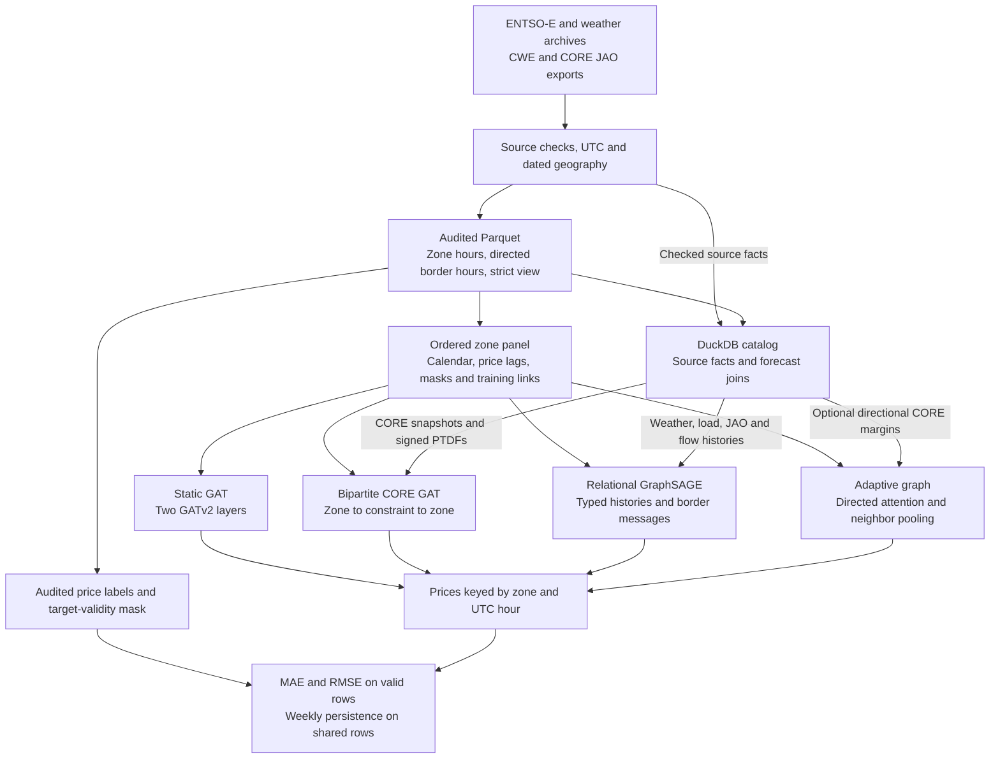

# Code walkthrough

## Architecture overview

The research task is to predict hourly day-ahead prices for bidding zones at
noon Brussels time on the previous local calendar day. The graph studies share
the audited delivery grid and use different ways to pass information between
zones. Their archived inputs support retrospective comparisons under the timing
and availability assumptions below. [Experiment record](experiments.md)

The standalone HTML guide includes a diagram for each model and a timeline for
the France example. [Architecture diagrams](architecture.html)



| Model | What happens inside the graph | Implementation |
|---|---|---|
| Static GAT | Hourly zone features pass through two GATv2 layers with self-loops and directed physical links observed during training. Each layer uses the same hour's graph, and a shared head emits one price per zone. | [`PriceGAT`](../epgnn/experiment_suite/neural.py#L64) |
| Bipartite CORE GAT | Zone states send messages to hourly historical constraint nodes with RAM, Fmax and RAM/Fmax attributes. Messages come back along the reversed incidence edges using the same signed PTDF edge features. The local zone state feeds the price head even when the constraint graph is empty. | [`Snapshots` and `ConstraintGAT`](../epgnn/relational_forecast/graph.py#L58), [input assembly](../epgnn/relational_forecast/experiment.py#L261) |
| Relational GraphSAGE | Typed encoders pool price, weather, load and JAO histories into zone states. Observed directed physical borders carry messages between endpoint zones, with separate incoming and outgoing mean aggregates. For each delivery hour, a shared price head combines the daily context with that hour's calendar and price-lag features. | [`RelationEncoder` and `RelationalGNN`](../epgnn/combined_graph_study/models.py#L133), [daily input windows](../epgnn/combined_graph_study/inputs.py#L54) |
| Adaptive graph | Calendar and recent prices encode each hourly zone state. Sender and receiver embeddings help score directed pairs, with optional corrections from historical CORE margins. Attention is normalized across incoming sources before neighbor states are pooled for the price head. | [`AdaptiveGNN`](../epgnn/combined_graph_study/models.py#L221), [directional margin features](../epgnn/combined_graph_study/inputs.py#L117) |

## Data transformation walkthrough

### From supplied exports to keyed tables

1. **Check source identity and keys.** The importer extracts the three pinned
   ENTSO-E v1.2 members for prices, load forecasts and physical flows, plus the
   supplied unversioned weather member. It checks ZIP CRC-32 and pinned MD5s.
   The manifest records SHA-256 and the weather release identity is unverified.
   The build resolves the supplied combined CWE/CORE JAO export, including zone
   summaries, border observations, coverage and detailed constraint observations
   with provenance. The audit checks hourly keys, duplicates and row counts, and
   reconciles constraint keys and timestamps with their provenance.
   [Input configuration](../configs/dataset_construction.json), [archive importer](../epgnn/dataset_build/import_archives.py#L13), [source manifest](../epgnn/dataset_build/storage.py#L88), [audit](../epgnn/dataset_build/pipeline.py#L119)
2. **Normalize time and map dated identities.** Source timestamps are normalized
   to nanosecond UTC for the audited tables. The crosswalk retains original
   ENTSO-E codes and names. `DE_AT_LU` ends and `DE_LU` becomes valid at the
   Brussels delivery-day boundary for 2018-10-01 (2018-09-30 22:00 UTC).
   Unresolved areas retain an `ENTSOE:<EIC>` identity. The Germany-only weather
   series carries a proxy flag on `DE_LU` and remains outside `DE_AT_LU`.
   JAO retains regime, dated membership and source timestamp status.
   [UTC and geography contracts](../epgnn/dataset_build/contracts.py#L18), [source adapters](../epgnn/dataset_build/construct.py#L10), [dated crosswalk](../epgnn/dataset_build/pipeline.py#L222), [JAO dimensions](../epgnn/relational_forecast/catalog.py#L156)
3. **Build the calendar and left-join observations.** The node key is
   `(zone, ts_utc)` on the complete hourly UTC price calendar. The edge key is
   `(from_zone, to_zone, ts_utc)` over the union of directed physical and JAO
   border pairs. Brussels local date determines the split and previous-day
   noon origin. The UTC key keeps both occurrences of the repeated autumn
   hour. Presence flags record whether a source row exists, valid published
   zeros stay numeric, and missing rows or unusable values can leave a null.
   Structural absences such as out-of-lifetime price zones and JAO zones
   outside the dated regional membership have their own flags or classes.
   Physical flow, CWE allocated BEC, CORE scheduled exchange and MaxBex retain
   their respective meanings.
   [Calendar](../epgnn/dataset_build/contracts.py#L44), [grid construction](../epgnn/dataset_build/pipeline.py#L188), [node and edge joins](../epgnn/dataset_build/construct.py#L110)
4. **Expose the same data in DuckDB.** `forecast_target` and `strict_forecast`
   read the audited Parquet grid. Raw source views join to calendar and geography
   dimensions for the historical facts. `jao_domain_hour` is keyed by regime
   and UTC hour, `cnec_observation` by `cnec_key`, and `cnec_ptdf` by
   `(cnec_key, zone)`. A zero coefficient is a catalog value. A missing
   coefficient has no row in the long PTDF view.
   [Catalog views](../epgnn/relational_forecast/catalog.py#L67), [catalog build](../epgnn/relational_forecast/catalog.py#L308)

### From tables to tensors and scores

- **Panel and graph links.** The saved benchmark sorts 94,967 UTC hours and 62
  historical price identities into `x[hour, zone, feature]`, `y[hour, zone]`
  and `active[hour, zone]`, keeping the same axis order for graph indices. Its
  250 directed physical links have a source row in pretrain or train and both
  endpoints in the price grid. The static GAT gates each link by the structural
  activity of both endpoints at that hour. The benchmark selects 49 evaluation
  zones with at least one valid label in each of fit, validation and test. The
  static and CORE paths can use the full panel for graph context. The combined
  study slices the panel and remaps the links to the 49-zone roster.
  [Benchmark tensor preparation](../epgnn/experiment_suite/data.py#L74), [CORE inputs](../epgnn/relational_forecast/experiment.py#L27), [combined study inputs](../epgnn/combined_graph_study/inputs.py#L137)
- **Feature masks and timing.** Delivery or effective time identifies the hour a
  value describes. Interval completion is one hour later. Publication time
  identifies when that version became available. The audited strict registry
  admits calendar and dated membership features by default. Admitting historical
  price lags there requires evidence of publication by origin as well as an
  earlier, completed interval. The retrospective benchmark uses the prior-day
  auction convention and conditional load, weather and JAO inputs in applicable
  variants. Lagging JAO by 48 hours establishes that the source interval ended
  before origin. The archived domain can enter the conditional join with a null
  publication time, while the strict CORE view requires a verified timestamp.
  Neural preprocessing fits imputation and scaling on training inputs and adds
  missingness indicators. Relational pooling also gates observations on source
  presence, available publication timestamps and zone activity.
  [Lag joins and strict registry](../epgnn/dataset_build/contracts.py#L94), [CORE join](../epgnn/relational_forecast/catalog.py#L144), [preprocessing](../epgnn/experiment_suite/neural.py#L29), [relational input masks](../epgnn/combined_graph_study/models.py#L91), [leakage audit](leakage_audit.md)
- **Label masks.** A finite, source-valid, unfilled price in its lifetime becomes
  a target. The target mask gates training loss and scoring independently of
  feature availability. Predictions use exact `(zone, ts_utc)` keys and are
  scored in EUR/MWh where the target is valid. Weekly persistence comparisons
  additionally require a finite same-zone weekly lag on the same rows.
  [Price admission](../epgnn/dataset_build/construct.py#L40), [masked loss](../epgnn/train.py#L14), [static scoring](../epgnn/experiment_suite/evaluation.py#L10), [CORE scores](../epgnn/relational_forecast/experiment.py#L199), [combined study evaluation](../epgnn/combined_graph_study/runner.py#L59)

### France at 2024-07-08 18:00 UTC

The ENTSO-E area `10YFR-RTE------C` maps to `FR`. The delivery key is in
validation at 20:00 Brussels time on Monday, July 8. Its forecast origin is
July 7 at 10:00 UTC (12:00 Brussels time). The recorded delivery price is
**103.21 EUR/MWh** with `target_valid=true`, so this row contributes to scoring.
[Calendar and target views](../epgnn/relational_forecast/catalog.py#L67)

| Lookup | Saved value and timing decision |
|---|---|
| Daily price at `t − 24h` | **48.94 EUR/MWh** on July 7 at 18:00 UTC. The hour belongs to an earlier Brussels delivery date, so the prior-day auction guard keeps it even though its delivery interval ends after the origin. The archive leaves the auction revision vintage unverified. |
| Weekly price at `t − 168h` | **71.18 EUR/MWh** on July 1 at 18:00 UTC. The exact same-zone interval ended at 19:00 UTC, before origin. The value supplies a recent-price feature and the paired persistence forecast, subject to the same historical vintage limitation. |
| CORE domain at `t − 48h` | The July 6 18:00 UTC domain is present and its interval ended at 19:00 UTC, before origin. `published_utc` is null, so the strict CORE lookup yields no row. The conditional snapshot contains **113** presolved rows. France's flat summary has **107** presolved constraints and minimum RAM/Fmax of approximately **0.199769**. |

- **Static zone node.** France's node receives local calendar values (hour 20,
  weekday 0, month 7) and both price lags. The flat-CORE static variant appends
  the two summary values and domain presence (`1`). The first suite's richer
  static GAT also receives delivery-hour load (**44,900 MW**) and four lag-48
  weather fields, including temperature (**18.18 °C**). The active incoming
  physical links into France at this hour are from `BE`, `CH`,
  `DE_LU`, `ES` and `IT_NORD`. [Daily guard and feature lists](../epgnn/experiment_suite/data.py#L18), [flat JAO join](../epgnn/boosting.py#L298), [static and CORE inputs](../epgnn/relational_forecast/experiment.py#L261)
- **Bipartite graph.** The France node receives the same calendar, price lags
  and flat CORE summary as the flat-CORE static variant. The 113 historical rows
  supply separate constraint nodes. France has 107 finite nonzero PTDFs and
  six recorded zeros, yielding 107 edges in each message direction for the real
  snapshot. One constraint has RAM **219 MW**, Fmax **312 MW** and a signed
  France coefficient of **−0.00002** on both passes.
  [Constraint extraction and graph batching](../epgnn/relational_forecast/graph.py#L16)

These values are from the saved `staging/relational_forecast/current/forecast.duckdb`
and the benchmark cache pinned by the CORE configuration. The catalog manifest,
source manifest and tensor metadata identify the same audited dataset generation.
[CORE configuration](../configs/experiments/relational_forecast.json), [catalog location and schema](relational_forecast.md#tables-and-keys)

## Current packages

The [experiment record](experiments.md) is the result overview. Training code is
preserved under its recorded fingerprints; documentation/report maintenance
does not relabel old checkpoints as new implementations.

| Package | Responsibility |
|---|---|
| `epgnn/dataset_build/` | Audited source joins, historical geography and time contract |
| `epgnn/experiment_suite/` | First five-model programme and shared data/scoring |
| `epgnn/controlled_study/` | Five-seed static, graph and original temporal controls |
| `epgnn/airport_study/` | Airport-observation variants |
| `epgnn/partner_gru/` | Residual GRU with native GPU RNN operations and CPU checks |
| `epgnn/reporting/` | Read-only result validation and notebook investigations |
| `scripts/reports/` | Consolidated document and executed notebook builders |
| `scripts/experiments/check_*gru_backend.py` | Read-only same-weight CPU/fused/native GPU comparisons |

The original controlled GRU training path is affected by the fused backend on
shuffled inputs. Its implementation is retained for reproduction; it should not
be used for new scientific fits before a separately fingerprinted correction.

## First five-model suite

`python -m epgnn.experiment_suite` enters `__main__.py`. Commands are `gpu-smoke`,
`france`, `full` and `status`; use `status --saved` for the completed historical run.

| Module | Responsibility |
|---|---|
| `data.py` | Read the audited grid zone by zone; guard price lags, join historical JAO, construct training topology and neighbour inputs; write memory-mapped tensors |
| `neural.py` | Train-only imputation/scaling, two-layer `PriceGAT`, GPU batches, epoch training, inference and resumable checkpoints |
| `gpu.py` | Real/shuffled operator checks and interrupted-versus-continuous training verification |
| `evaluation.py` | Unique keyed prediction tables, common-mask persistence scores, pooled country/overall MAE and RMSE |
| `artifacts.py` | Atomic JSON publication |
| `runner.py` | Fingerprints, checked cache loading, XGBoost fits, launch locks, France gate and sequential experiment orchestration |

Training flows from **audited Parquets → checked tensor cache → model fit → keyed
predictions → scores and checksums**. CLI functions dispatch work; they do not
parse arguments when imported. The shell launcher adds persistent logs and an
exit-code file for use inside tmux.

The runner still exposes `gpu_smoke`, `evaluate`, `grouped_scores` and `write_json`
imports for compatibility with existing callers. Implementations live in their
focused modules above.

## Dataset and earlier baselines

`epgnn/dataset_build/` owns the source/geography/time contract and atomic dataset
construction. `epgnn/boosting.py` provides the earlier strict/conditional boosting
runner and reusable scoring/history helpers. `boosting_batch.py` coordinates
country batches. The suite reuses those contracts rather than the original
history/sample tensors.

Original modules under `epgnn/data/` and `epgnn/models/` belong to the separate
legacy pipeline; [legacy notes](legacy_pipeline.md) explain which are implemented.
The suite's GAT is in `experiment_suite/neural.py`.

## Reproducibility during maintenance

Source hashes deliberately change after formatting or module extraction. Old
models and metrics keep their old fingerprints and remain reproducible from the
recorded Git implementation. Inspection with `status --saved` is read-only and
does not authorize reusing an old model under changed code. Fresh code must pass
its own GPU/France gates before a new full run.

For this cleanup, existing training, feature and scoring function ASTs were
compared before/after extraction and formatting; the status/CLI inspection path
was the intentional behavior addition. Data, trained weights and metric summaries
remain unchanged. Regression tests cover timing, graph shuffling, inactive nodes,
preprocessing, missing-target losses and country aggregation.

The named compatibility check loads both original full-run graph checkpoints and
compares their first test batch with the saved predictions, without retraining:

```bash
.venv/bin/python scripts/experiments/check_saved_graph_models.py
```

To format the active suite and its tests, use Black 26.10.1:

```bash
uvx --from black==26.10.1 black epgnn/experiment_suite tests/test_experiment_suite.py
```

Keep changes to fingerprinted dataset builders and historical experiment scripts
separate from routine readability cleanup. Their hashes are part of prior builds.
